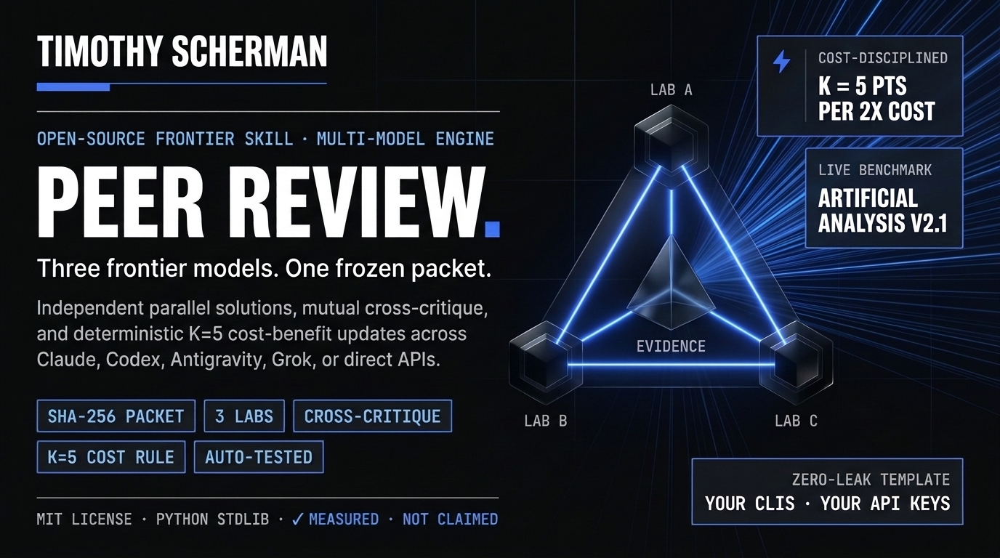
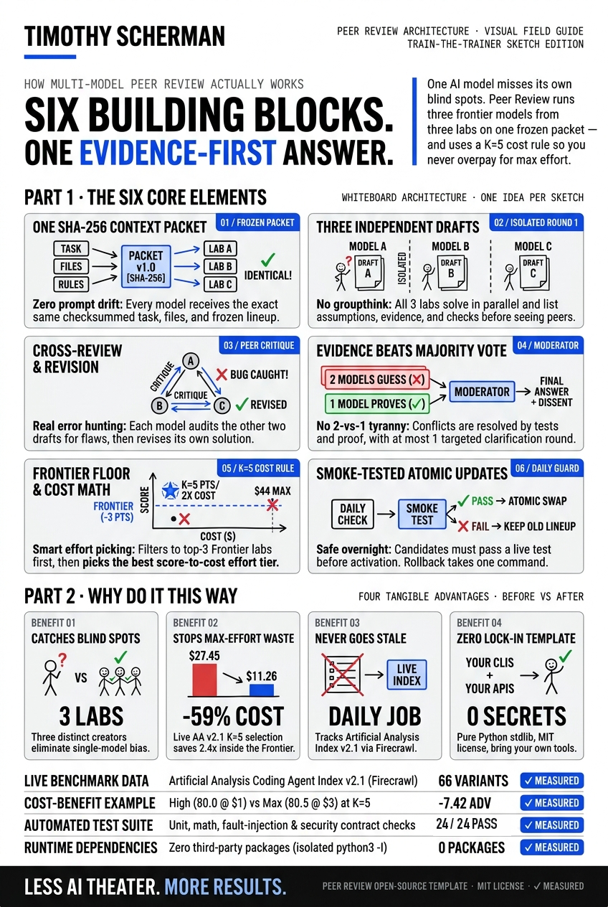

# PEER REVIEW

**Three frontier models from three different labs solve the same frozen context packet independently, critique each other's work, revise on evidence, and let a Moderator synthesize one reasoned answer — with daily Artificial Analysis cost-benefit auto-updates.**

> **Less AI theater. More results.** Bring your own coding-agent CLIs or provider API keys. Zero third-party dependencies, zero secrets in the repository, MIT licensed.

---

## Why Peer Review Exists (In Plain English)

When you ask a single AI model to solve a hard architecture, security, or debugging problem, you run into four real-world walls:

1. **Single-model blind spots** — one model repeats its own assumptions and confidently misses edge cases another lab catches immediately.
2. **Groupthink and prompt drift** — casually pasting different context into three chats contaminates independence and makes disagreements impossible to audit.
3. **Max-effort cost explosions** — blindly selecting the highest reasoning tier (`max` / `xhigh`) can triple or sextuple cost per task for less than half a benchmark point (or even a *lower* score).
4. **Stale model lists** — hardcoded model names rot within weeks as new releases and reasoning tiers shift the frontier.

**Peer Review solves all four.** It freezes one SHA-256-checksummed context packet, runs three frontier models from three distinct providers in parallel, executes structured cross-critique and revision, settles disputes by evidence rather than blind 2-vs-1 majority vote, and keeps its lineup fresh daily using live **Artificial Analysis Coding Agent Index vs. Cost per Task** data.

---

## How Peer Review Works — Visual Field Guide



---

## What the K = 5 Cost Rule Changes on Real Live Data (`✓ measured`)

Using live **Artificial Analysis Coding Agent Index v2.1** data (66 published coding-agent variants fetched via Firecrawl on 26 November 2026), compare a naive "pick the highest score / max effort" lineup against the deterministic Frontier + `K = 5` rule (3-point Frontier buffer below the 3rd strongest creator's best score):

| Creator | Agent Harness | Model & Effort | Coding Index (0–100) | Cost / Task (USD) | Selection Value (`K = 5`) | Decision (`K = 5`, Floor `50.47`) |
|---|---|---|---:|---:|---:|---|
| **Google** | Antigravity CLI | Gemini 4 Neon (`xhigh`) | **58.64** | **$6.86** | **44.75** | **Selected** (Seat 1) |
| Google | Antigravity CLI | Gemini 4 Carbon (`high`) | 55.47 | $9.75 | 39.04 | Rejected (lower score, higher cost) |
| **Anthropic** | Claude Code | Claude Fable 5.2 (`medium`) | **53.04** | **$2.89** | **45.39** | **Selected** (Seat 2) |
| Anthropic | Claude Code | Claude Fable 5.2 (`high`) | 58.24 | $7.51 | 43.69 | Rejected (+5.20 pts for 2.60x cost; needs > +6.89) |
| Anthropic | Claude Code | Claude Fable 5.2 (`xhigh`) | 58.47 | $15.47 | 38.72 | Rejected (+5.43 pts for 5.35x cost; needs > +12.10) |
| Anthropic | Claude Code | Claude Fable 5.2 (`max`) | 55.74 | $44.22 | 28.41 | Rejected (lower score than `high`, 5.9x pricier) |
| **OpenAI** | Codex | GPT-6.1 Sol (`max`) | **52.16** | **$1.51** | **49.20** | **Selected** (Seat 3) |
| OpenAI | Codex | GPT-6.2 Astra (`high`) | 52.28 | $2.37 | 46.05 | Runner-up (+0.12 pts for 1.57x cost; needs > +3.25) |
| OpenAI | Codex | GPT-6.2 Astra (`max`) | 53.47 | $5.12 | 41.69 | Rejected (+1.31 pts for 3.39x cost; needs > +8.81) |

- **Naive peak-score lineup** (`Gemini 4 Neon xhigh` + `Claude Fable 5.2 xhigh` + `GPT-6.2 Astra max`): **$27.45 / benchmark task** (or **$56.20** if you pick `max` on Claude!).
- **`K = 5` Frontier lineup** (`Gemini 4 Neon xhigh` + `Claude Fable 5.2 medium` + `GPT-6.1 Sol max`): **$11.26 / benchmark task** — **59% lower cost (2.4x cheaper)** while keeping all three providers inside the strict 3-point Frontier floor (`50.47`).
- Both `k_cost_doubling` (default `5.0`) and `quality_buffer` (default `3.0`) are configurable in your local `config.json`. Lower `K` or narrow the buffer if you want to pay more for top-tier effort.

---

## Quick Start (Bring Your Own CLIs or API Keys)

This repository is a clean open-source template. **Zero API keys, personal paths, or private timezones are included.** You bring your own credentials or locally signed-in coding-agent CLIs.

### Requirements

- **Python 3.10+** (pure standard library — **0 external pip packages**)
- **Firecrawl API key** (`FIRECRAWL_API_KEY`) for daily Artificial Analysis leaderboard refreshes (or a local snapshot file / custom bridge command)
- **At least 3 distinct model providers**, via either:
  - **Option A — Direct Provider APIs:** `ANTHROPIC_API_KEY`, `OPENAI_API_KEY`, `GEMINI_API_KEY`, and/or `XAI_API_KEY`, **or**
  - **Option B — Local Subscription CLIs:** signed-in `claude` (Claude Code), `codex` (Codex CLI), `agy` (Antigravity CLI), and/or `grok` (Grok CLI)

### 1. Clone and Install

```bash
git clone https://github.com/Tomi2k/peer-review.git
cd peer-review
./install.sh
```

What `install.sh` does:
1. Copies the pure-Python runtime to `~/.local/share/peer-review/`.
2. Installs isolated wrappers `~/.local/bin/peer-review` and `~/.local/bin/peer-review-update` (invoking `python3 -I`).
3. Installs `SKILL.md` for every supported agent CLI found (`Claude Code`, `Codex`, `Antigravity CLI`, `Grok`) and records SHA-256 hashes in `manifest.txt` for safe `--uninstall`.
4. Seeds `~/.config/peer-review/config.json` (mode `0600`) only if no config exists yet.

### 2. Configure Your Backends

Pick one of the two templates in `examples/`:

- **API keys:** edit `~/.config/peer-review/config.json` (seeded from `examples/config.api.example.json`) and export `FIRECRAWL_API_KEY`, `ANTHROPIC_API_KEY`, `OPENAI_API_KEY`, `GEMINI_API_KEY` (or configure `api_key_command` for your own secret manager).
- **Local CLIs:** copy `examples/config.cli.example.json` to `~/.config/peer-review/config.json` and sign into your installed CLIs (`claude`, `codex`, `agy`, `grok`).

### 3. Initialize Your Frontier Lineup & Run a Peer Review

```bash
# Fetch Artificial Analysis Coding Agent Index v2.1, run K=5 selection, smoke-test candidates, activate atomically:
peer-review-update

# Inspect active lineup:
peer-review status

# Run a 3-provider Peer Review:
peer-review run \
  --task "Find bugs, edge cases, and security issues in this parser." \
  --file src/parser.py \
  --constraint "No breaking public API changes" \
  --output-format "Patch + verification commands"
```

Or invoke directly inside Claude Code, Antigravity CLI, Grok, or Codex as a skill:

```text
/peer-review review the uncommitted authentication changes
```

---

## Technical Deep Dive

### 1. Versioned Context Packet & Frozen Lineup (`peer_review/context_packet.py`)

Every run builds a canonical JSON `ContextPacket` (`schema_version: "1.0"`) containing the user's exact task, attached files (with per-file SHA-256 digests and a 512 KiB safety cap), constraints, and requested output format. A canonical **SHA-256 checksum** (`packet_sha256`) is calculated and re-verified before every stage. At run start, the active 3-seat lineup is frozen in memory so a concurrent background lineup update never alters an in-flight review.

### 2. Four-Stage Isolated Protocol (`peer_review/review_runner.py`, `prompts.py`)

1. **Round 1 — Independent Parallel Solutions:** All three providers execute concurrently (`ThreadPoolExecutor`) on the exact same checksummed packet without seeing each other's outputs. Each reports its solution, decisive assumptions, evidence, uncertainties, and (for coding tasks) both a verification plan and which checks were actually executed.
2. **Round 2a — Mutual Peer Critique:** Each surviving model receives the original packet plus ONLY the *other two* models' Round 1 solutions. It identifies concrete defects, missed requirements, unsupported assumptions, better approaches, and peer contributions worth adopting.
3. **Round 2b — Evidence-Driven Revision:** Each model receives the critiques targeting its own Round 1 work, revises its solution, and explains what changed versus where it holds its ground.
4. **Optional Clarification Round (Hard Cap: 1):** The Moderator inspects revised outputs for a material, answer-changing technical contradiction. If found, it triggers at most **one** targeted clarification round with a single concrete question or verifiable test.
5. **Moderator Synthesis:** Produces an independent final answer ordered as: (1) directly usable result first, (2) key Peer Review corrections, (3) remaining material dissent with practical impact and resolving check, (4) exact model versions, creators, effort levels, packet SHA-256, and `COMPLETE` / `INCOMPLETE` status. Majority vote alone never overrides technical evidence.

If any participant fails during any stage, the runner finishes cleanly with the remaining models and marks the run **`INCOMPLETE`** in both the final output and archived `run_result.json`.

### 3. Deterministic Frontier + Cost-Benefit Selection (`peer_review/selector.py`)

- **Same-Source Integrity (`aa_scraper.py`):** Uses Firecrawl (`executeJavascript` on `https://artificialanalysis.ai/agents/coding-agents`) to read the published Next.js Flight JSON behind **"Artificial Analysis Coding Agent Index vs. Cost per Task"**, resolving chunk references (`$hex`) so all variants keep exact floating-point scores and average API costs per task (USD). Never estimates values from pixels.
- **Frontier Pre-Filter (before cost):** Computes each usable creator's highest comparable score, takes the **3rd strongest creator's best score** as the reference, and filters to `score >= reference - quality_buffer` (default `3.0`). Cheap non-frontier models cannot win via low price. If fewer than 3 distinct creators are reliably evaluable, selection is flagged `incomplete`.
- **Economic Advantage (`K = 5` default):**
  ```text
  QualityGain        = Score_new - Score_old
  CostFactor         = Cost_new / Cost_old
  EconomicAdvantage  = QualityGain - K * log2(CostFactor)
  SelectionValue     = Score - K * log2(Cost_USD / 1 USD)
  ```
  - Strictly `> 0`: candidate wins.
  - `== 0` or `< 0`: active variant stays.
  - Tie-breaker order: active variant first, then lower cost per task, then alphabetically first `variant_id`.
  - Update assignment matches same-creator proposals to their existing seat first, then compares new creators (descending `SelectionValue`) against replaceable seats (ascending `SelectionValue`).
  - Missing, zero, or cross-index-version data gaps retain the active seat and emit a data-gap notice.

### 4. Reproducible Smoke Tests, Atomic Swaps & Notifications (`smoke_test.py`, `lineup_store.py`, `notifier.py`)

- Before any seat changes, the candidate `(model_id, effort)` runs a reproducible smoke test using a frozen context packet to verify model acceptance, constraint adherence, and usable code-review output.
- Failed smoke tests or scrape/API errors leave `active_lineup.json` untouched.
- Verified lineups activate atomically (`temp` -> `fsync` -> `os.replace`) while archiving prior revisions under `<state_dir>/history/` for instant 1-command rollback (`peer-review rollback`).
- Every switch, smoke-test hold, data gap, and newly detected cost-rejected leaderboard peak is formatted with full math and provenance, deduplicated by SHA-256 fingerprint (never spammed twice), saved durably to `<state_dir>/notifications.jsonl` and `notifications.md`, and optionally posted to a configured HTTPS Slack or generic webhook (`PEER_REVIEW_WEBHOOK_URL`).

### 5. Daily Scheduling, Manual Snapshots & Notifications (`deploy/`)

Ready-to-edit scheduler templates live in `deploy/` (defaulting to `UTC`; set your own IANA timezone in your local unit/plist/cron):
- macOS `launchd`: `deploy/com.peer-review.updater.plist.example`
- Linux `systemd`: `deploy/peer-review-updater.service.example` + `deploy/peer-review-updater.timer.example`
- Cron: `deploy/cron.example`

For offline evaluation or when using the official Artificial Analysis API instead of live scraping, pass `--snapshot path/to/snapshot.json` to `peer-review-update`. Expected `BenchmarkSnapshot` JSON structure:

```json
{
  "index_version": "v2.1",
  "source_url": "https://artificialanalysis.ai/agents/coding-agents",
  "fetched_at_utc": "2026-11-26T00:00:00Z",
  "notes": [],
  "variants": [
    {
      "variant_id": "openai-gpt-6-1-sol-max",
      "creator_slug": "openai",
      "creator_name": "OpenAI",
      "model_release": "GPT-6.1 Sol",
      "model_version": "GPT-6.1 Sol (Max)",
      "agent_slug": "codex",
      "agent_name": "Codex",
      "effort": "max",
      "coding_agent_index": 52.16,
      "cost_per_task_usd": 1.51,
      "index_version": "v2.1",
      "source_url": "https://artificialanalysis.ai/agents/coding-agents",
      "fetched_at_utc": "2026-11-26T00:00:00Z"
    }
  ]
}
```

---

## Security & Privacy Model

- **Zero Secrets in Repository:** All credentials come from environment variables (`FIRECRAWL_API_KEY`, `ANTHROPIC_API_KEY`, `OPENAI_API_KEY`, `GEMINI_API_KEY`, `XAI_API_KEY`, `PEER_REVIEW_WEBHOOK_URL`) or a user-configured explicit argv secret command (`shell=False`). `config.json` is opened via `dir_fd` + `O_NOFOLLOW` without `.resolve()`; symlinked, group/world-writable (`mode & 0o022 != 0`), or foreign-owned config files are rejected unconditionally via `fstat` before parsing.
- **Read-Only Local CLI Defaults, MCP Disabling & Workspace Isolation:** Under `review.read_only=true` (default), local CLI adapters enforce read-only/plan/sandbox flags and disable MCP servers where supported: `claude` runs with `--setting-sources user --permission-mode plan --disable-slash-commands --no-session-persistence --strict-mcp-config --tools ""` (built-in tools and MCP disabled unconditionally); `codex` runs `exec -s read-only --ignore-user-config` (sandboxed, user config/MCP skipped); `agy` runs `--input-format stream-json --mode plan --sandbox` with an inline read-only settings policy denying `mcp(*)`, `write_file(*)`, `read_file(*)`, `command(*)`, and URL tools (custom `settings_path` is blocked in read-only mode); `grok` runs `--permission-mode plan --no-memory --no-subagents --disable-web-search --tools ""` (built-in tools disabled; **note:** the `grok` CLI currently does not expose a flag to disable user-configured MCP servers in `$GROK_HOME`/`$HOME` — use direct `xai` API mode if you configure MCP servers in `grok`). Whenever `--cwd` is omitted (both via CLI and direct Python `invoke_model` calls), child CLIs execute inside an empty `0700` temp directory under `<state_dir>/tmp` so untrusted repo hooks and configs do not run (never pass `--cwd` pointing at an untrusted repository). **Scope note:** Local CLI sandboxes such as `codex -s read-only` still permit read access to `$HOME`-readable files by design; do not pass untrusted, prompt-injected repositories into local CLI mode — use direct HTTP API mode (`examples/config.api.example.json`) or an OS container for untrusted inputs. Under `review.read_only=true`, `extra_args` uses a strict 5-flag allowlist (`--verbose`, `--quiet`, `--no-color`, `--color=<val>`, `--max-budget-usd=<val>`) placed before mandatory flags, and custom `command` backends require explicit `allow_in_read_only: true` opt-in.
- **Recursion Guard, Process-Group Timeouts & Allowlisted Subprocess Environment:** Child CLIs run in their own process group (`start_new_session=True`) so timeouts terminate the entire tree via `SIGKILL`, and receive a minimal allowlisted environment (`PATH`, `HOME`, `LANG`, proxy/CA/CLI-home vars, explicit `passthrough_env`, and private `TMPDIR` under `<state_dir>/tmp`) plus `PEER_REVIEW_NESTED=1`, preventing unrelated host credentials (`GITHUB_TOKEN`, cloud keys, DB URLs) from leaking and blocking recursive `peer-review run` calls.
- **No Shell Injection, Symlink Exfiltration, or Module Hijacking:** All subprocesses run with `shell=False`; `model_id`, `effort`, and `run_id` are validated strictly against non-hyphenated allowlists. Attached `--file`, `--task-file`, `--snapshot`, and persisted state JSON files fail closed without `O_NOFOLLOW`, walk path components with `dir_fd` + `O_DIRECTORY | O_NOFOLLOW`, and verify `S_ISREG`/size via `fstat` before reading. `build_context_packet()` refuses obvious secret files (`.env`, `.env.*`, SSH keys, `*.pem`/`*.key`, PEM private-key headers). Prompts pass via `stdin` (including `agy` NDJSON `stream-json`) or `0600` files inside `0700` dirs under `<state_dir>/tmp` — never on `argv`. Installed wrappers run `python3 -I`.
- **HTTPS-Only & No Redirect Forwarding:** Remote API, snapshot `source_url`, and webhook calls require clean `https://` URLs without userinfo, whitespace, or control characters (`http://` is only accepted for local `localhost`/`127.0.0.1`/`::1` API gateways), disable HTTP 3xx redirect following (`NoRedirectHandler`), and cap HTTP response and error body reads.
- **Prompt Injection Framing, Output Redaction & Slack Escaping:** Attached user files (512 KiB/file, 2 MiB total), peer outputs, clarification prompts, and failure logs are wrapped in per-call randomized boundaries and marked as untrusted data. All participant and Moderator outputs (including Stage 3 clarification `dispute` and `question` fields) pass through `redact_secrets` before cross-provider forwarding and archiving. Slack webhook payloads escape `<`, `>`, and `&`.
- **Atomic Locked State & Strict Directory Ownership:** `state_dir` is preserved without `.resolve()`; `ensure_private_dir()` walks components via `dir_fd` + `O_DIRECTORY | O_NOFOLLOW`, verifies ancestor ownership (`st_uid in (geteuid(), 0)`), and applies `fchmod(fd, 0o700)` on the opened directory fd. State files use `0600`, atomic writes use `O_CREAT | O_EXCL | O_NOFOLLOW` + `fchmod(0600)` + `fsync`, and lineup/notification mutations serialize through `fcntl.flock`. PEM private keys, common cloud/Git/API token prefixes, quoted/escaped/unquoted header and `.env` secrets, Slack webhook URLs, URL userinfo, and query secrets are redacted from outputs, errors, and logs. C0/C1/ANSI/OSC and BiDi control characters are stripped before terminal display.
- **Zero Telemetry:** No analytics, no tracking, no unsolicited outbound calls.

---

## Verification & Tested Environment

| Check | Mode | Result |
|---|---|---|
| 3 mandatory `K = 5` worked examples (`-7.42`, `+1.39`, `0.00`) | Automated unit test (`tests/test_selector.py`) | **PASS** (`✓ measured`) |
| Multi-effort same model, Frontier floor, tie-breakers, missing/zero cost, index-version boundary, `<3` creators | Automated unit test (`tests/test_selector.py`, `tests/test_security.py`) | **PASS** (`✓ measured`) |
| Full 3-stage Peer Review flow, SHA-256 verification, mid-run concurrent lineup freeze, max 1 clarification round, participant failure -> `INCOMPLETE` | Automated integration test with mock invoker (`tests/test_review_flow.py`) | **PASS** (`✓ measured`) |
| Smoke-test failure preserving active lineup, atomic activation + rollback, rejected-peak & deduplicated notifications | Automated integration test (`tests/test_updater.py`) | **PASS** (`✓ measured`) |
| Hostile inputs (spaces/quotes in filenames, symlinks, prompt injection text, shell/flag metacharacters, `extra_args` override flags, non-HTTPS endpoints, installer symlink refusal, planted `json.py` isolation, `run_id` traversal, recursive nested run refusal) | Full automated test suite (`tests/test_selector.py`, `tests/test_scraper.py`, `tests/test_review_flow.py`, `tests/test_updater.py`, `tests/test_security.py`) | **24 / 24 PASS** (`✓ measured`) |
| Live Artificial Analysis Coding Agent Index v2.1 scrape via Firecrawl | **Real external interface** (`artificialanalysis.ai/agents/coding-agents`) | **66 variants extracted** (`✓ measured`) |
| Live `peer-review-update` initial staffing + live smoke tests across 3 providers | **Real CLI interfaces** (OpenAI Codex, Anthropic Claude Code, Google Antigravity CLI) | **3/3 seats verified & activated atomically** (caught real quota limit on primary Anthropic model via smoke test and verified fallback Frontier model cleanly) (`✓ measured`) |
| Live multi-round `peer-review run` end-to-end | **Real CLI interfaces** (OpenAI `GPT-6.1 Sol max`, Anthropic `Claude Opus 5.5 max`, Google `Gemini 4 Neon xhigh`, Moderator `Claude Opus 5.5 high`) | **Round 1: 3/3 completed; Round 2a/2b + Moderator completed with 2/3** after 1 seat hit the 600 s timeout in Round 2a — surfaced real peer-caught bugs, preserved dissent, and flagged run **`INCOMPLETE`** (exit 3) as designed (`✓ measured`) |

### Limits & Terms of Service Notice

- **Third-Party Terms of Service:** Before enabling automated daily refreshes, review the [Artificial Analysis Terms of Use](https://artificialanalysis.ai/terms-of-use) (and prefer their official API or manually saved `--snapshot` files if your usage requires commercial/automated licensing). Likewise, verify each model vendor's subscription terms before running unattended scheduled jobs against consumer CLI subscriptions — pay-per-token API keys (`examples/config.api.example.json`) are the standard path for automated pipelines.

- Tested on **macOS** with **Python 3.10+** (verified on Python 3.14) and local coding-agent CLIs (`claude`, `codex`, `agy`). Direct HTTP provider API adapters (`anthropic`, `openai`, `google`, `xai`) are unit-tested for validation and error/redirect handling, not exercised against paid direct API billing keys during release testing.
- Linux `systemd --user` and `cron` templates follow standard user-service conventions and should be verified on your target Linux host before relying on unattended daily updates.
- High-effort (`max` / `xhigh`) frontier models can exceed 10 minutes per turn on complex prompts; adjust `review.timeout_seconds` in `~/.config/peer-review/config.json` to match your models and latency budget.
- Artificial Analysis page structure can change over time. If the embedded Next.js Flight schema changes, `aa_scraper.py` fails closed and preserves your active lineup untouched rather than guessing values from chart images.
- Direct provider API effort parameter names evolve across SDK versions (`output_config.effort`, `reasoning.effort`, `thinkingConfig.thinkingLevel`). The reproducible smoke test catches unsupported effort parameters before any lineup switch activates.

---

## License

MIT License — Copyright (c) 2026 Timothy Scherman. See [LICENSE](LICENSE).

---

Built by **Timothy Scherman**. Less AI theater. More results.
